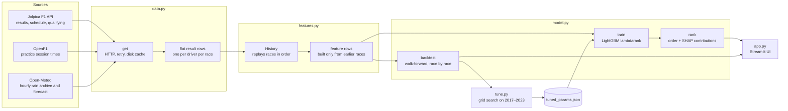

# my-formula-1

A machine-learning web app that predicts the finishing order of the next Formula 1 race. A LightGBM ranking model learns from every race since 2013 how car pace, driver form, track history and weather turn into a race result. A Streamlit app shows the prediction, the reasons behind it, and how accurate the model has been.

## Why this repo exists

A race result comes mainly from three things: **the car**, **the driver** and **the track**. Each one is easy to describe but hard to weigh by hand:

- **Car performance** changes during a season as teams bring upgrades. A team that is climbing should be rated above its season average.
- **Driver performance** is hidden by the car. The fairest measure is how a driver does against their teammate in the same machine.
- **Track performance** depends on the circuit and the conditions. Some drivers keep shining at certain circuits or in the rain.
- **Regulation changes** reshuffle everything. In 2014, 2017, 2022 and 2026 the technical rules were rewritten. Last year's form suddenly means much less, some teams adapt far better than others, and new problems appear that teams spend months fixing, such as porpoising in 2022.

How much does a good wet-weather record matter compared with a two-place gap to a teammate? Rather than guess weights, this project **learns them from history**. It also keeps the model explainable: every prediction shows which factors pushed each driver up or down, and a walk-forward backtest shows how the model would have done on races that have already run.

## Quick start

```
pip install -r requirements.txt
streamlit run app.py
```

The first launch downloads every season since 2013 along with practice times and race-day weather, which takes a few minutes. After that, completed seasons load from `.cache/` in seconds. Use **Refresh data** in the sidebar to pull the latest sessions, for example after each practice session or qualifying.

### Run with Docker Desktop

```
docker compose up -d --build
```

Then open http://localhost:8501. Downloaded seasons are kept in the `f1-cache` volume, so restarts and rebuilds don't download them again. To update the app after changing the code, run the same command again.

### Security

This is a personal tool meant to run on your own computer, not a public service. The setup keeps it that way:

| Measure | Where | Why |
|---|---|---|
| Port published on `127.0.0.1` only | [docker-compose.yml](docker-compose.yml) | Only this computer can open the app; other devices on your Wi-Fi or network can't. Streamlit has no login, so don't change this to `8501:8501`. |
| Runs as a non-root user | [Dockerfile](Dockerfile) | A bug in the app can't act as root inside the container. |
| Read-only file system | `read_only`, `tmpfs` | Nothing can change the app's code at runtime. Only the data cache and `/tmp` are writable. |
| No Linux capabilities, no privilege escalation | `cap_drop`, `no-new-privileges` | The container gets none of the extra kernel permissions it doesn't need. |
| Memory and process limits | `mem_limit`, `pids_limit` | A runaway process can't slow down the rest of your computer. |
| Pinned package versions | [requirements.txt](requirements.txt) | Rebuilds install the same, known versions instead of whatever is newest. |
| Viewer-only toolbar; XSRF and CORS checks on | `CMD` in [Dockerfile](Dockerfile) | Hides Streamlit's developer menu and blocks requests from other websites. |

The app makes only outgoing HTTPS requests to Jolpica, OpenF1 and Open-Meteo, and takes no user input beyond the sidebar controls. Cached responses are stored as plain JSON, never pickled, so a tampered cache file can't run code. Streamlit's startup log prints an "External URL" that is only informational. The app is not reachable on it.

## One race at a time

The app predicts only the **next race**, from what is known at that moment:

1. **Before the weekend**: history only. This means earlier seasons plus this season's races so far (car pace and trend, driver form, gap to teammate, track record, weather forecast).
2. **After each practice session**: also each driver's practice pace (best lap compared with the session's fastest lap).
3. **After qualifying**: also the starting grid. The app switches to the model trained with grid positions.

The page header shows which stage the prediction is at. The **Model accuracy** tab replays past races the same way: each race is predicted by a model trained only on the races before it. It never predicts a season in one go.

```
python test_model.py   # offline checks: no data leakage, and the model learns a known order
python tune.py         # re-tune model settings (a few minutes); writes tuned_params.json
```

## The app

| Tab | What it shows |
|---|---|
| **Next race** | Predicted finishing order, the top 3 as headline cards, key inputs per driver (car pace, car trend, gap to teammate, track record), and a chart of how much each factor group pushed each driver up or down. Practice times are used as soon as any practice session has run. Before qualifying it uses the pre-qualifying model; once the grid is published, it switches to the model that also uses grid positions. |
| **Model accuracy** | How each prediction method did on the held-out seasons (2024 onward): rank correlation, winner correct, podium drivers correct. Also accuracy by regulation phase, accuracy per season, and which features the model relies on. |
| **Race explorer** | Pick any held-out race to compare the predictions with the actual result. |

The sidebar lets you override the weather (forecast / dry / wet) to see how the prediction changes in the rain.

## Architecture



| File | Responsibility |
|---|---|
| [data.py](data.py) | Downloads race results and qualifying from Jolpica, practice times from OpenF1, and rain during each race from Open-Meteo. Retries on rate limits and dropped connections, and caches responses that won't change. |
| [features.py](features.py) | Replays every race in date order. Before each race it computes that race's features from earlier races only, then adds the race's result to the history. This makes data leakage impossible by construction. |
| [model.py](model.py) | Trains the ranking model, ranks a field with per-feature SHAP contributions, reports feature importance, and runs the walk-forward backtest over any set of seasons. Loads tuned settings from `tuned_params.json`. |
| [tune.py](tune.py) | Grid search over model settings, scored by walk-forward validation on the tuning seasons, followed by one report on the held-out seasons, with and without the regulation features. Runs in parallel across CPU cores. |
| [app.py](app.py) | The Streamlit interface. Caches the downloads, the trained models and the backtest. |
| [test_model.py](test_model.py) | Synthetic-data checks: changing a race's result never changes its own features, and the model learns an obvious car and driver order. |

## Features

Each driver in each race is described by 17 features in the three categories, plus two from the race weekend itself:

| Group | Feature | Meaning |
|---|---|---|
| **Car** | `car_level` | Team's average finishing position this season, weighted toward the last few races (half-life 3 races) |
| | `car_trend` | Slope of the team's results over its last 6 races this season. This is upgrade momentum, including teams fixing early problems (negative = improving). |
| | `car_prev_season` | Team's average finish over the last 10 races of the previous season. It is kept separate from `car_level` so the model learns how much last year carries over, which is very little after a rule reset. |
| | `car_dnf_rate` | Team's share of cars that didn't finish over the last 10 races (reliability) |
| | `car_track` | Team's past results at this circuit compared with its season average (how well the car suits the track) |
| | `reg_change` | 1 in a season that resets the technical regulations (2014, 2017, 2022, 2026) |
| | `rules_age` | Races run under the current regulations so far. Early in a new era, form is thin and moves fast. |
| | `season_races` | Races run this season, which tells the model how much evidence `car_level` and `car_trend` rest on |
| | `car_reg_adapt` | How the team did at previous rule resets: its average finish in the first 8 races of the new rules minus its last 8 under the old rules (negative = adapted well) |
| **Driver** | `driver_form` | Driver's recent finishing positions (half-life 5 races) |
| | `teammate_delta` | Places ahead of or behind the teammate (half-life 8 races), which separates driver skill from the car |
| | `driver_dnf_rate` | Driver's share of races not finished over their last 10 |
| | `starts` | Experience: races in the dataset |
| **Track & conditions** | `track_delta` | Driver's past results at this circuit compared with their season average. Past races in the same conditions count double. |
| | `track_visits` | How many times the driver has raced here |
| | `wet` | Whether the race is expected to be wet (more than 0.5 mm of rain in the first 3 hours) |
| | `wet_delta` | Driver's results in wet races compared with their season average |
| **This weekend** | `practice` | Best lap in free practice compared with the fastest lap of the same session, in %, taking the driver's best session. Empty before the first session, and for races before 2023 (OpenF1 starts in 2023). |
| | `grid` | Starting position (used only by the after-qualifying model) |

Car history follows a team through rebrands: Force India → Racing Point → Aston Martin, Toro Rosso → AlphaTauri → RB, Sauber → Alfa Romeo → Sauber → Audi, Lotus → Renault → Alpine, and Marussia → Manor. The mapping is `LINEAGE` in [features.py](features.py).

Missing values (rookies, first visits to a track, `car_level` before a season's first race) are left empty. LightGBM handles them natively rather than having them filled with guesses.

## Model

- **Learning to rank, not regression.** The model uses LightGBM's `lambdarank` objective with each race as a query group. It learns to *order* the drivers within a race, which is the actual question, rather than predicting a finishing position for each driver independently. Higher places get more weight, so mistakes at the front cost more than mistakes in the midfield.
- **Two models.** One is trained without `grid` for predictions before qualifying, the other with `grid` for after qualifying. The app picks the right one automatically.
- **Trained on finishers.** Retirements are mostly bad luck, so the model learns the order of drivers who finished. Reliability still enters through the retirement-rate features.
- **Monotone constraints.** A worse car pace, driver form or grid slot can never improve a driver's predicted position. This keeps the model sensible on a small dataset.
- **Tuned, not guessed.** `tune.py` picked 15 leaves per tree, at least 20 rows per leaf, a learning rate of 0.03 and 100 rounds. All of the top ten configurations scored within 0.005 of each other, so the model is not sensitive to these settings.
- **Explainable.** The app calculates each prediction's SHAP contributions with LightGBM's built-in `pred_contrib`, then sums them into the Car / Driver / Track & conditions / Qualifying groups.

## Evaluation

### Why not k-fold cross-validation
Standard k-fold shuffles races into random folds, so the model would train on later races and be tested on earlier ones. In F1 that leaks the future: a model that has seen October knows which cars got faster, which makes March look easy. The scores would come out too optimistic. Instead, every evaluation here is **walk-forward**: each race is predicted by a model trained only on the races before it, just like a real prediction.

### Tuning set and held-out set
| Seasons | Used for |
|---|---|
| 2013–2016 | Training history only. They are never scored. |
| **2017–2023** (145 races, including the 2017 and 2022 resets) | **Tuning:** `tune.py` tries 36 setting combinations and keeps the one with the best rank correlation |
| **2024–2026** (65 races, including the 2026 reset) | **Held out:** never looked at during tuning, and reported once. These are the numbers to trust. |

Scores measure the order of drivers who finished. Rank correlation is the Spearman correlation between the predicted and actual order (1 = perfect).

### Results on the held-out seasons (2024–2026, 65 races)

| Prediction | Rank correlation | Winner correct | Podium drivers correct (of 3) |
|---|---|---|---|
| Model + grid | **0.812** | 52% | 2.14 |
| Model, before qualifying (with practice) | 0.727 | 35% | 1.69 |
| Grid order only (baseline) | 0.790 | **66%** | **2.23** |

By regulation phase (rank correlation):

| Phase | Model + grid | Model, before qualifying | Grid order only |
|---|---|---|---|
| Stable rules (2024–2025) | 0.81 | 0.72 | 0.78 |
| Rule reset 2026, rounds 1–5 | 0.80 | 0.70 | 0.86 |
| Rule reset 2026, round 6+ | 0.84 | 0.79 | 0.80 |

What this shows:
- **Once qualifying is known, the model orders the whole field better than the grid does**, in both the tuning seasons (0.823 vs 0.759) and the held-out seasons (0.812 vs 0.790).
- **Practice pace helps a little before qualifying.** Adding it raised the before-qualifying model from 31% to 35% winners correct and from 1.59 to 1.69 podium drivers. It barely changes the after-qualifying model, because the grid already reflects the same pace. Practice data only goes back to 2023, so the model has few races to learn its weight from, and it should improve as seasons accumulate.
- **It is worse than pole position at picking the winner.** The model spreads its attention across the whole order, while pole position wins the race about two-thirds of the time. If the winner matters most to you, trust pole position.
- **Early in a rule reset, qualifying beats history.** In 2026 rounds 1–5, past form said little, and the grid was the best guide. That fits the intuition: when the regulations change, the first qualifying sessions show the new pecking order before race history catches up.

### Do the regulation features help?
`tune.py` retrains without `car_prev_season`, `reg_change`, `rules_age`, `season_races` and `car_reg_adapt`, then compares (measured before the practice feature was added):

| Rank correlation, before qualifying | With regulation features | Without |
|---|---|---|
| Tuning seasons, 2017 and 2022 resets, rounds 1–5 | **0.742** | 0.717 |
| Tuning seasons, overall | 0.771 | 0.765 |
| Held-out seasons, 2026 reset, rounds 1–5 | 0.697 | 0.720 |
| Held-out seasons, overall | 0.723 | 0.731 |

The regulation features help a little where you'd expect, in the first races after the 2017 and 2022 resets, and are neutral elsewhere. On the 2026 reset (only 5 races) they didn't help. The honest reason is that the data contains just three earlier resets (2014, 2017, 2022) to learn from, so "how well does a team adapt to new rules" rests on one to three examples per team.

## Configuration

| Setting | Where | Default |
|---|---|---|
| First season loaded | `FIRST_SEASON` in [data.py](data.py) | 2013 |
| Tuning and held-out seasons | `TUNE_SEASONS`, `TEST_FROM` in [model.py](model.py) | 2017–2023, 2024+ |
| Settings search grid | `GRID` in [tune.py](tune.py) | 36 combinations |
| Model settings | `CONFIG` in [model.py](model.py), overridden by `tuned_params.json` | see above |
| Regulation reset seasons, team renames | `REG_CHANGES`, `LINEAGE` in [features.py](features.py) | – |
| Wet-race threshold | `WET_MM` in [data.py](data.py) | 0.5 mm |
| Feature definitions | `History.features` in [features.py](features.py) | – |

After changing features, run `python tune.py` and compare its held-out report with the numbers above. Don't adjust things based on the held-out results too often, or they stop being held out.

## Data sources

- [Jolpica F1](https://github.com/jolpica/jolpica-f1), the community successor to the Ergast API: results, schedule and qualifying. No API key is needed. It allows about 4 requests per second, which the app respects.
- [OpenF1](https://openf1.org): free practice classifications (best lap per driver per session) from 2023 on. One request per season. No API key is needed.
- [Open-Meteo](https://open-meteo.com): hourly rain from the historical archive and the 16-day forecast. No API key is needed.

Responses that won't change (finished seasons, older weather) are cached in `.cache/`, which git ignores.

## Limitations and ideas

- **Not modelled yet:** tuning for winner accuracy specifically, win and podium probabilities (e.g. by simulating many races from the model's scores), sprint races, practice long-run pace, grid penalties, tyre strategy and safety-car likelihood.
- New rule resets and team renames must be added by hand to `REG_CHANGES` and `LINEAGE`.
- Only three past resets exist to learn from, so the model can't reliably predict which team will nail a new set of rules.
- Wet races are rare, so the model has little to learn from about rain.
- Races more than 16 days away have no forecast and are treated as dry unless you switch to **Wet** in the sidebar.
- Before qualifying, the field is assumed to be the line-up from the last race.
