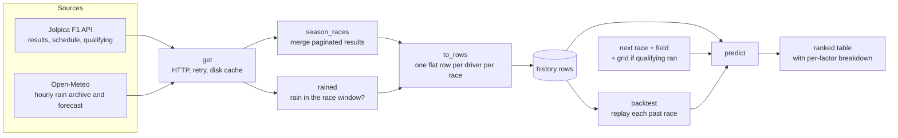

# my-formula-1

A command-line tool that predicts the finishing order of the next Formula 1 race. It needs only Python 3.12+ and no third-party packages.

```
$ python f1predict.py
2026 United States Grand Prix (2026-10-25) - dry (forecast), qualifying not run yet

 P  driver                team           score   car   drv track  rain
 1  Max Verstappen        red_bull         1.6   4.0  -2.1  -0.2  +0.0
 2  Charles Leclerc       ferrari          3.0   3.9  -0.4  -0.5  +0.0
 3  Lewis Hamilton        ferrari          3.9   3.9  +0.4  -0.4  +0.0
 ...
```

## Why this repo exists

A race result comes mainly from three things: **the car**, **the driver** and **the track**. Most quick predictions use only one of them, such as the championship standings or last week's winner. This project combines all three in one transparent score:

- **Car performance** changes during a season as teams bring upgrades. A team that has improved over the last five races should be rated higher than its season average suggests.
- **Driver performance** is hard to see on its own because a fast car flatters its drivers. The fairest measure is how a driver does against their teammate in the same car.
- **Track performance** depends on the circuit and the conditions. Some drivers keep doing well at certain circuits or in the rain, so a driver's past results at this circuit and in similar weather should count.

The goal is a model you can **read, question and tune**, not a black box. Every prediction shows how much each factor contributed. A built-in backtest shows how well the model would have predicted races that have already run.

## Quick start

```
python f1predict.py              # predict the next race
python f1predict.py --rain wet   # force wet or dry conditions (default: use the forecast)
python f1predict.py --backtest   # score the model on this season's past races
python test_f1predict.py         # offline checks on synthetic data
```

The first run downloads about four seasons of results and weather, which takes a minute or two. After that, completed seasons load from `.cache/`.

## Architecture

The whole tool is one script, [f1predict.py](f1predict.py), with three stages: **fetch → normalise → predict**.



| Function | Responsibility |
|---|---|
| `get` | Sends an HTTP GET request and retries on rate limits and dropped connections. Responses that won't change (finished seasons, historical weather) are cached to disk. |
| `season_races` | Downloads a season's results from Jolpica, page by page, and joins any race that is split across pages. |
| `rained` | Sums the rain during the three hours from the race start. Races more than 60 days ago use the Open-Meteo archive; recent and upcoming races use the forecast endpoint. |
| `to_rows` | Turns the API data into flat rows: season, round, circuit, wet, driver, team, grid, position, finished. |
| `predict` | Takes history rows, the entry list, the circuit, the conditions and an optional grid, and returns the finishing order with a breakdown for each driver. It does no input/output, so the tests and the backtest can call it directly. |
| `backtest` | For each race this season, predicts the result using only the races before it and compares that with what actually happened. |
| `main` | Handles the command-line options, finds the next race and the field (the last race's entrants, or the qualifying entry list once it exists), and prints the table. |

## Model design

Every factor is measured in **finishing positions**, so the factors can be added together, and the final score reads as an expected finishing position. A lower score is better.

```
score = car + driver + track + rain
score = 0.5 × score + 0.5 × grid          (only once qualifying has run)
```

### Car: current level plus development trend
1. For each race, take the team's average finishing position across its cars.
2. **Level:** an exponentially weighted average of those values with a half-life of 3 races, so recent races matter most.
3. **Trend:** the slope of a straight line fitted to the team's last 6 races. This projects upgrade momentum forward by one race. A team gaining one place per race moves up one place.
4. Once the current season has 3 races, only this season is used. This matters for new rules, such as the 2026 regulations, which reset the pecking order.

### Driver: teammate comparison
The driver's finishing position minus their team's average in each race, weighted with a half-life of 8 races. Comparing teammates cancels out the car. Because it uses whichever car the driver was in at the time, a driver's rating carries over when they change teams.

### Track: circuit history in matching conditions
The driver's results at this circuit compared with their own average for that season. This shows whether they usually do better or worse here than they normally do. Past visits in the same conditions (wet or dry) count fully, and visits in the other conditions count half. The result is multiplied by 0.5 because track history is a noisy signal.

### Rain: wet-weather skill
The driver's results in wet races compared with their season average. This is applied only when the race is expected to be wet. A race counts as wet if more than 0.5 mm of rain falls in the three hours from the start.

### Shared design choices
- **Races a driver didn't finish are ignored.** A failure or a crash says little about pace, and ignoring them keeps reliability noise out of the pace estimates.
- **Small samples are pulled toward zero.** The driver, track and rain factors include 3 imaginary races at zero, so one lucky result at a circuit can't dominate. Rookies start at 0 and move toward their real level as races come in.
- **Additive and explainable.** Each factor is shown in the output, so you can see why a driver is ranked where they are.
- **Pure prediction function.** `predict` takes data and returns a ranking. The backtest replays history through the same code the live prediction uses, so it can't drift from it.

## How well it works

Results of `--backtest` on the 2026 season (rounds 4–17). Each race was predicted using only the races before it. The score is the Spearman rank correlation between the predicted and actual order of drivers who finished, where 1.0 is a perfect prediction.

| Prediction | Mean |
|---|---|
| Model, before qualifying | 0.81 |
| Grid order only (baseline) | 0.80 |
| Model blended with grid | 0.84 |

Before qualifying, the model is about as accurate as knowing the grid. Once the grid is known, combining the two beats either one alone.

## Configuration

All the settings are constants at the top of [f1predict.py](f1predict.py). After changing one, run `--backtest` to check that it helps.

| Constant | Default | Effect |
|---|---|---|
| `SEASONS` | 4 | Seasons of history to load |
| `CAR_HALF_LIFE` | 3 | How quickly old car results fade |
| `DRIVER_HALF_LIFE` | 8 | How quickly old driver results fade |
| `TREND_WINDOW` / `TREND_WEIGHT` | 6 / 1.0 | Races used to measure upgrade momentum, and how far it is projected forward |
| `TRACK_WEIGHT` | 0.5 | Weight of circuit history |
| `GRID_WEIGHT` | 0.5 | Weight of grid position once qualifying has run |
| `SHRINK` | 3 | Imaginary races at zero that keep small samples from dominating |
| `WET_MM` | 0.5 | Millimetres of rain during the race that make it wet |

## Data sources

- [Jolpica F1](https://github.com/jolpica/jolpica-f1), the community successor to the Ergast API: results, schedule and qualifying. No API key is needed. It allows about 4 requests per second, which the tool respects.
- [Open-Meteo](https://open-meteo.com): hourly rain from the historical archive and the 16-day forecast. No API key is needed.

Responses that won't change are cached in `.cache/` (ignored by git). Delete the folder to download everything again.

## Project layout

```
f1predict.py        all fetching, modelling and output
test_f1predict.py   synthetic-data checks: faster car, teammate gap, upgrade trend, track/rain specialist
```

## Limitations and ideas

- **Not modelled yet:** win and podium probabilities (Monte Carlo over the score spread), car reliability (how often a team fails to finish), how well each team's car suits a type of circuit, sprint races, practice long-run pace and grid penalties.
- The weights are reasonable first guesses and haven't been tuned. A small grid search scored by `--backtest` would be the next step.
- Wet races are rare, so the rain factor is based on few races and is heavily pulled toward zero.
- Races more than 15 days away have no forecast, so they are treated as dry unless you pass `--rain wet`.
