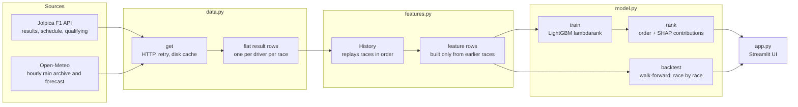

# my-formula-1

A machine-learning web app that predicts the finishing order of the next Formula 1 race. A LightGBM ranking model learns from eight seasons of results how car pace, driver form, track history and weather turn into a race result. A Streamlit app shows the prediction, the reasons behind it, and how accurate the model has been.

## Why this repo exists

A race result comes mainly from three things: **the car**, **the driver** and **the track**. Each one is easy to describe but hard to weigh by hand:

- **Car performance** changes during a season as teams bring upgrades. A team that is climbing should be rated above its season average.
- **Driver performance** is hidden by the car. The fairest measure is how a driver does against their teammate in the same machine.
- **Track performance** depends on the circuit and the conditions. Some drivers keep shining at certain circuits or in the rain.

How much does a good wet-weather record matter compared with a two-place gap to a teammate? Rather than guess weights, this project **learns them from history**. It also keeps the model explainable: every prediction shows which factors pushed each driver up or down, and a walk-forward backtest shows how the model would have done on races that have already run.

## Quick start

```
pip install -r requirements.txt
streamlit run app.py
```

The first launch downloads about eight seasons of results and race-day weather, which takes a few minutes. After that, completed seasons load from `.cache/` in seconds. Use **Refresh data** in the sidebar to pull the latest results, for example after qualifying.

```
python test_model.py   # offline checks: no data leakage, and the model learns a known order
```

## The app

| Tab | What it shows |
|---|---|
| **Next race** | Predicted finishing order, the top 3 as headline cards, key inputs per driver (car pace, car trend, gap to teammate, track record), and a chart of how much each factor group pushed each driver up or down. Before qualifying it uses the pre-qualifying model; once the grid is published, it switches to the model that also uses grid positions. |
| **Model accuracy** | How each prediction method did this season (rank correlation, winner correct, podium drivers correct), accuracy per race, and which features the model relies on. |
| **Race explorer** | Pick any past race this season to compare the predictions with the actual result. |

The sidebar lets you override the weather (forecast / dry / wet) to see how the prediction changes in the rain.

## Architecture



| File | Responsibility |
|---|---|
| [data.py](data.py) | Downloads race results and qualifying from Jolpica, and rain during each race from Open-Meteo. Retries on rate limits and dropped connections, and caches responses that won't change. |
| [features.py](features.py) | Replays every race in date order. Before each race it computes that race's features from earlier races only, then adds the race's result to the history. This makes data leakage impossible by construction. |
| [model.py](model.py) | Trains the ranking model, ranks a field with per-feature SHAP contributions, reports feature importance, and runs the walk-forward backtest. |
| [app.py](app.py) | The Streamlit interface. Caches the downloads, the trained models and the backtest. |
| [test_model.py](test_model.py) | Synthetic-data checks: changing a race's result never changes its own features, and the model learns an obvious car and driver order. |

## Features

Each driver in each race is described by 13 features in the three categories, plus qualifying:

| Group | Feature | Meaning |
|---|---|---|
| **Car** | `car_level` | Team's average finishing position, weighted toward the last few races (half-life 3 races). Uses only the current season once it has 3 races, because new regulations reset the pecking order. |
| | `car_trend` | Slope of the team's results over the last 6 races, which captures upgrade momentum (negative = improving) |
| | `car_dnf_rate` | Team's share of cars that didn't finish over the last 10 races (reliability) |
| | `car_track` | Team's past results at this circuit compared with its season average (how well the car suits the track) |
| **Driver** | `driver_form` | Driver's recent finishing positions (half-life 5 races) |
| | `teammate_delta` | Places ahead of or behind the teammate (half-life 8 races), which separates driver skill from the car |
| | `driver_dnf_rate` | Driver's share of races not finished over their last 10 |
| | `starts` | Experience: races in the dataset |
| **Track & conditions** | `track_delta` | Driver's past results at this circuit compared with their season average. Past races in the same conditions count double. |
| | `track_visits` | How many times the driver has raced here |
| | `wet` | Whether the race is expected to be wet (more than 0.5 mm of rain in the first 3 hours) |
| | `wet_delta` | Driver's results in wet races compared with their season average |
| **Qualifying** | `grid` | Starting position (used only by the after-qualifying model) |

Missing values (rookies, first visits to a track) are left empty. LightGBM handles them natively rather than having them filled with guesses.

## Model

- **Learning to rank, not regression.** The model uses LightGBM's `lambdarank` objective with each race as a query group. It learns to *order* the drivers within a race, which is the actual question, rather than predicting a finishing position for each driver independently. Higher places get more weight, so mistakes at the front cost more than mistakes in the midfield.
- **Two models.** One is trained without `grid` for predictions before qualifying, the other with `grid` for after qualifying. The app picks the right one automatically.
- **Trained on finishers.** Retirements are mostly bad luck, so the model learns the order of drivers who finished. Reliability still enters through the retirement-rate features.
- **Monotone constraints.** A worse car pace, driver form or grid slot can never improve a driver's predicted position. This keeps the model sensible on a small dataset.
- **Small on purpose.** Each tree has 7 leaves, with at least 40 rows per leaf and 100 boosting rounds. The dataset has about 3,400 rows, and larger settings did worse in the backtest.
- **Explainable.** The app calculates each prediction's SHAP contributions with LightGBM's built-in `pred_contrib`, then sums them into the Car / Driver / Track & conditions / Qualifying groups.

## Evaluation

The model is evaluated with a **walk-forward backtest**: for each race of the current season, a model is trained only on the races before it and then predicts that race. The scores measure the order of drivers who finished.

2026 season, rounds 4–17 (14 races):

| Prediction | Rank correlation | Winner correct | Podium drivers correct (of 3) |
|---|---|---|---|
| Model + grid | **0.84** | 71% | **2.21** |
| Model, before qualifying | 0.81 | 29% | 2.00 |
| Grid order only (baseline) | 0.80 | 71% | 2.14 |

Before qualifying, the model ranks the field about as well as knowing the grid does. Once the grid is known, the model beats grid order on overall order and podium, and ties it on the winner. Fourteen races is a small sample, so treat differences of a few hundredths as noise.

## Configuration

| Setting | Where | Default |
|---|---|---|
| Seasons of history | `SEASONS` in [app.py](app.py) | 8 |
| Model settings | `PARAMS`, `ROUNDS`, `MONOTONE` in [model.py](model.py) | see above |
| Wet-race threshold | `WET_MM` in [data.py](data.py) | 0.5 mm |
| Feature definitions | `History.features` in [features.py](features.py) | – |

After changing anything, check the **Model accuracy** tab to see whether the change helps.

## Data sources

- [Jolpica F1](https://github.com/jolpica/jolpica-f1), the community successor to the Ergast API: results, schedule and qualifying. No API key is needed. It allows about 4 requests per second, which the app respects.
- [Open-Meteo](https://open-meteo.com): hourly rain from the historical archive and the 16-day forecast. No API key is needed.

Responses that won't change (finished seasons, older weather) are cached in `.cache/`, which git ignores.

## Limitations and ideas

- **Not modelled yet:** win and podium probabilities (e.g. by simulating many races from the model's scores), sprint races, practice long-run pace, grid penalties, tyre strategy and safety-car likelihood.
- When a team is renamed (for example `alphatauri` → `rb`), the new name starts with no history, so its car features are thin for the first few races.
- Wet races are rare, so the model has little to learn from about rain.
- Races more than 16 days away have no forecast and are treated as dry unless you switch to **Wet** in the sidebar.
- Before qualifying, the field is assumed to be the line-up from the last race.
